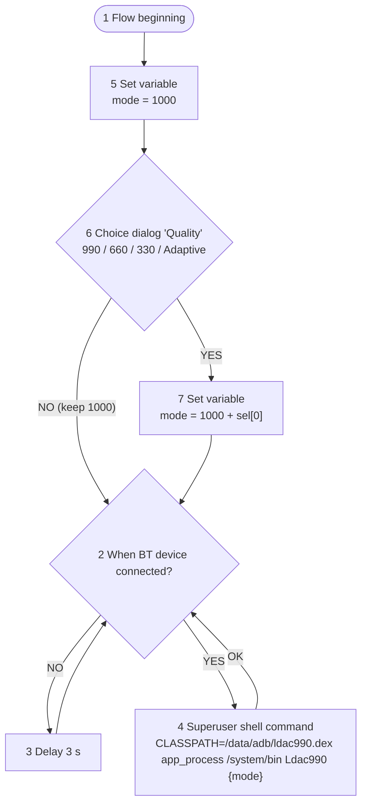

# android-bt-codec-switch

Switch the **LDAC bitrate** of a connected Bluetooth headset (e.g. Sony WF-1000XM5) from *Best effort (ABR)* to *Best quality (990 kbps)* on a rooted Android phone, without paid apps or opening Developer options. Driven by the free **Automate** app.

Tested on OnePlus (OxygenOS / ColorOS, Android 15/16, KernelSU) with Sony WF-1000XM5.

## How it works
`Ldac990.java` is a small headless program run through `app_process` as root. It:
1. binds to the A2DP profile via `BluetoothAdapter.getProfileProxy`,
2. reads the current codec config of every connected device,
3. for devices using LDAC (codec type 4) calls `setCodecConfigPreference` with the same sample rate/bits/channel mode, but `codecSpecific1` = requested LDAC quality.

Exit codes: `0` changed, `1` no LDAC device connected, `2` error, `3` profile proxy failed, `4` timeout, `5` no adapter.

| Argument | LDAC mode |
|---|---|
| `1000` (default) | Optimized for audio quality (990 kbps) |
| `1001` | Normal (660 kbps) |
| `1002` | Optimized for connection (330 kbps) |
| `1003` | Best effort (adaptive) |

## Requirements
- Root (KernelSU / Magisk / APatch). Automate needs to be granted superuser.
- Automate (LlamaLab) from Google Play.
- Headset connected over LDAC (enable LDAC in the headset's companion app, e.g. Sony Sound Connect → "Prioritize sound quality").

## Install
`/data/adb` is root-only and survives reboots; you can't `adb push` there directly, so push to `/sdcard` first:
```sh
adb push ldac990.dex ldac.sh /sdcard/
adb shell su -c 'cp /sdcard/ldac990.dex /sdcard/ldac.sh /data/adb/ && chmod 644 /data/adb/ldac990.dex && chmod 755 /data/adb/ldac.sh && rm /sdcard/ldac990.dex /sdcard/ldac.sh'
# test (headset connected); no argument = 1000 (990 kbps):
adb shell su -c 'CLASSPATH=/data/adb/ldac990.dex app_process /system/bin Ldac990'
```
`ldac.sh` accepts an optional mode (default `1000`) and rejects anything outside 1000–1003 (exit 64).
Then check Developer options → *Bluetooth audio LDAC codec*: it should show *Optimized for audio quality*.

### Build the dex yourself (optional)
```sh
javac --release 8 -cp android.jar -d out Ldac990.java   # android.jar from the Android SDK (platform 34+)
d8 --min-api 30 --output . out/Ldac990.class && mv classes.dex ldac990.dex
```

## Automate setup
Import the community flow **[Bluetooth Codec Changer (with mode choice)](https://llamalab.com/automate/community/flows/54032)**: open the link on the phone, or go to Automate → Community → "Bluetooth Codec Changer".

### Blocks (numbers as in the flow)
1. **Flow beginning** → 5.
5. **Set variable**: `mode` = `1000` (default) → 6.
6. **Choice dialog** "Quality": choices `990 kbps`, `660 kbps`, `330 kbps`, `Adaptive` (in this order, *Sort* off), selected indices → `sel`.
   - **YES** (choice made) → 7.
   - **NO** (cancelled or timed out) → 2, keeping the default 1000.
7. **Set variable**: `mode` = `1000 + sel[0]` → 2.
   Dialog choice returns an **array of 0-based indices** ([docs](https://llamalab.com/automate/doc/block/dialog_choice.html)), so `sel[0]` is 0–3 and `mode` becomes 1000–1003.
2. **When Bluetooth device connected?** *(field: Device)*: select your headphones (e.g. WF-1000XM5) or leave it at *any*.
   - **NO** → 3.
   - **YES** → 4.
3. **Delay**: 3 s → 2.
4. **Superuser shell command**:
   ```
   CLASSPATH=/data/adb/ldac990.dex app_process /system/bin Ldac990 {mode}
   ```
   **OK** → 2. Without an argument, `Ldac990` falls back to 1000.

### Flowchart


**Superuser access:** grant Automate root in **KernelSU** (KernelSU Manager → Superuser → enable Automate). Otherwise block 4 fails. Then start the flow. For set-and-forget, enable *Run on system startup* in Automate settings.

> Android may reset the LDAC mode on reconnect, which is why the flow keeps looping.

## Disclaimer
Use at your own risk. This only changes a runtime Bluetooth codec preference; nothing is written to system partitions.
