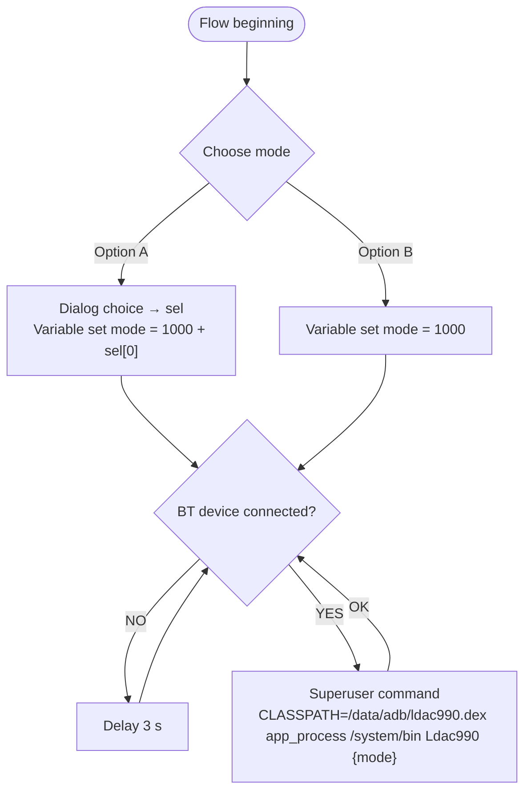

# android-bt-codec-switch

Switch the **LDAC bitrate** of a connected Bluetooth headset (e.g. Sony WF-1000XM5) from *Best effort (ABR)* to *Best quality (990 kbps)* on a rooted Android phone, without paid apps or opening Developer options. Driven by the free **Automate** app.

Tested on OnePlus (OxygenOS / ColorOS, Android 15/16, KernelSU) with Sony WF-1000XM5.

## How it works
`Ldac990.java` is a small headless program run through `app_process` as root. It:
1. binds to the A2DP profile via `BluetoothAdapter.getProfileProxy`,
2. reads the current codec config of every connected device,
3. for devices using LDAC (codec type 4) calls `setCodecConfigPreference` with the same sample rate/bits/channel mode, but `codecSpecific1` = requested LDAC quality.

Exit codes: `0` changed, `1` no LDAC device connected, `2` error, `3` profile proxy failed, `4` timeout, `5` no adapter.

| Argument | LDAC mode |
|---|---|
| `1000` (default) | Optimized for audio quality (990 kbps) |
| `1001` | Normal (660 kbps) |
| `1002` | Optimized for connection (330 kbps) |
| `1003` | Best effort (adaptive) |

## Requirements
- Root (KernelSU / Magisk / APatch). Automate needs to be granted superuser.
- Automate (LlamaLab) from Google Play.
- Headset connected over LDAC (enable LDAC in the headset's companion app, e.g. Sony Sound Connect → "Prioritize sound quality").

## Install
`/data/adb` is root-only and survives reboots; you can't `adb push` there directly, so push to `/sdcard` first:
```sh
adb push ldac990.dex ldac.sh /sdcard/
adb shell su -c 'cp /sdcard/ldac990.dex /sdcard/ldac.sh /data/adb/ && chmod 644 /data/adb/ldac990.dex && chmod 755 /data/adb/ldac.sh && rm /sdcard/ldac990.dex /sdcard/ldac.sh'
# test (headset connected); no argument = 1000 (990 kbps):
adb shell su -c 'CLASSPATH=/data/adb/ldac990.dex app_process /system/bin Ldac990'
```
`ldac.sh` accepts an optional mode (default `1000`) and rejects anything outside 1000–1003 (exit 64).
Then check Developer options → *Bluetooth audio LDAC codec*: it should show *Optimized for audio quality*.

### Build the dex yourself (optional)
```sh
javac --release 8 -cp android.jar -d out Ldac990.java   # android.jar from the Android SDK (platform 34+)
d8 --min-api 30 --output . out/Ldac990.class && mv classes.dex ldac990.dex
```

## Automate setup
Import the community flow **[Bluetooth Codec Changer](https://llamalab.com/automate/community/flows/54031)** (open the link on the phone, or Automate → Community → search "Bluetooth Codec Changer"). The flow ships with two empty fields: the **device in block 2** and the **command in block 4**.

Flow layout: wait for a connection, run the root command once connected, keep looping.

1. **Flow beginning**: nothing to fill in. GO → block 2.
2. **Bluetooth device connected?** *(empty field: Device)*: select your headphones, e.g. `WF-1000XM5`, or leave it at *any* device.
   - **NO** → block 3.
   - **YES** → block 4.
3. **Delay**: 3 s, then back to block 2 (poll again).
4. **Superuser command** *(empty field: Command)*: enter
   ```
   CLASSPATH=/data/adb/ldac990.dex app_process /system/bin Ldac990
   ```
   Without an argument it falls back to `1000` (990 kbps). Alternatives: `... Ldac990 1001` or `sh /data/adb/ldac.sh 1000`.
   **OK** → loops back to the IN of block 2 (or through the delay).

### Optional: configurable mode
**Option A: ask every time (Dialog choice).** Insert a **Dialog choice** block between block 2 (YES) and block 4:
- *Choice titles*: `["990 kbps (quality)", "660 kbps (normal)", "330 kbps (connection)", "Best effort (adaptive)"]`
- *Sort*: **off** (keeps the list in mode order)
- *Selected indices*: variable `mode`

Per the [Automate docs](https://llamalab.com/automate/doc/block/dialog_choice.html), the output is an **array of selected indices** (0-based), even for a single choice. So `mode` = `[0]`…`[3]`, not 1000–1003. Map it in block 4's command:
```
CLASSPATH=/data/adb/ldac990.dex app_process /system/bin Ldac990 {1000 + mode[0]}
```
Connect the dialog's *Cancel* output back to block 2 (or straight to block 4 with no argument, for the 1000 default).

**Option B: fixed mode (Variable set).** Right after *Flow beginning*, add a **Variable set** block: variable `mode`, value `1000` (or 1001–1003). Block 4 command:
```
CLASSPATH=/data/adb/ldac990.dex app_process /system/bin Ldac990 {mode}
```

### Flowchart

With Option A, the dialog runs once per flow start. To keep block 4 identical for both options, store the dialog output in `sel` and add **Variable set** `mode` = `1000 + sel[0]` (Dialog choice returns a 0-based index array, not the value).

### What to change in your existing flow
1. Install the files to `/data/adb/` (see *Install*) and delete the old `/data/local/tmp` copies.
2. Option B: between *Flow beginning* and *BT device connected?*, add **Variable set** `mode` = `1000`.
   Option A: add **Dialog choice** there instead (titles in mode order, *Sort* off, output `sel`), followed by **Variable set** `mode` = `1000 + sel[0]`.
3. In *BT device connected?*, select your headphones (e.g. WF-1000XM5) or leave it at *any*.
4. In *Superuser command*, set the command to `CLASSPATH=/data/adb/ldac990.dex app_process /system/bin Ldac990 {mode}`.
5. Keep the loops as they are: NO → Delay 3 s → BT check, and OK → BT check.
6. Make sure Automate has superuser access in KernelSU, then restart the flow.

**Superuser access:** grant Automate root in **KernelSU** (KernelSU Manager → Superuser → enable Automate). Otherwise block 4 fails. Then start the flow. For set-and-forget, enable *Run on system startup* in Automate settings.

> Android may reset the LDAC mode on reconnect, which is why the flow keeps looping.

## Disclaimer
Use at your own risk. This only changes a runtime Bluetooth codec preference; nothing is written to system partitions.
